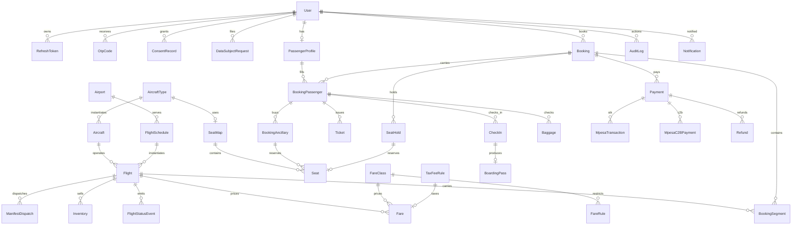
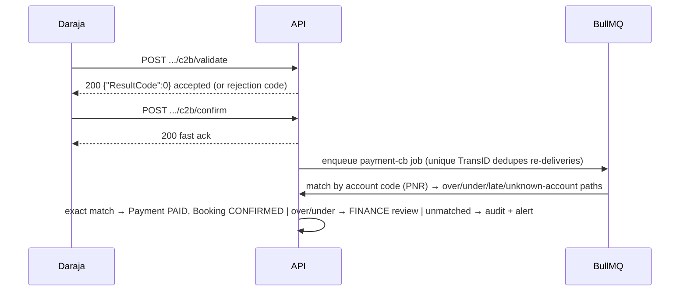

# Flight13 — Architecture

Companion to the [README](../README.md). Paths, contracts, and diagrams here are the
source of truth for implementation; where an earlier design note disagrees (for example the
M-Pesa callback path), this document wins.

## 1. System overview

```
                       ┌──────────────────────────────┐
  browser ──HTTPS────▶ │  apps/web  (Next.js :3000)   │  App Router, mobile-first,
                       │  server + client components  │  EN/SW, cookie locale
                       └──────────────┬───────────────┘
                                      │ REST /api/v1  +  Socket.IO /rt
                       ┌──────────────▼───────────────┐
                       │  apps/api   (NestJS :4000)   │
                       │  controllers → services      │
                       │  BullMQ workers · guards     │
                       └───┬──────────┬──────────┬────┘
                           │          │          │
                     Prisma│     Redis│          │ outbound
                           ▼          ▼          ▼
                     Postgres      Redis     Daraja (M-Pesa),
                     (source of    (cache,   Stripe, Africa's
                      truth)       queues,   Talking SMS,
                                   rate-     (mock via env flag)
                                   limits)
```

- **Monorepo**: pnpm workspaces — `apps/web`, `apps/api`, `packages/shared`.
- **`packages/shared`** holds every cross-app contract: money math, phone/MSISDN, PNR
  checksum, the booking-state transition table, M-Pesa result codes, WS event catalog,
  and API DTO types. No app re-implements these.
- **Config** is a single Zod-validated module (`apps/api/src/config/env.ts`). Boot fails
  loudly on invalid config; nothing reads `process.env` anywhere else.

## 2. Folder structure

```
apps/api
├── src
│   ├── config/env.ts            Zod env contract + loader (only place env is read)
│   ├── common/                  logger (PII masking), AES-GCM crypto, blind index,
│   │                            Nest↔structured-logger bridge
│   ├── prisma/                  PrismaModule (global), PrismaService ($connect/ping)
│   ├── redis/                   RedisModule (global), RedisService (ioredis)
│   ├── app.module.ts            module graph
│   ├── app.setup.ts             shared configureApp() used by main.ts AND e2e tests
│   ├── main.ts                  bootstrap (fatal-error logging)
│   └── modules/                 one folder per bounded context
│       ├── health/              /healthz /readyz
│       ├── meta/                /api/v1/meta
│       └── flights/             /api/v1/airports, search, fares, seat map, status
├── prisma/schema.prisma         35 models, 33 enums
├── prisma/migrations/
├── prisma/seed.ts               idempotent, re-runnable
└── test/                        Vitest + Supertest e2e

apps/web
└── src
    ├── app/                     App Router pages: flights, book, bookings/[id], pnr,
    │                            login/register, boarding-passes/[id] (server shells)
    ├── components/              site chrome, booking/payment/seat/check-in islands,
    │                            i18n-provider (client), shadcn-style ui primitives
    ├── lib/                     api-client (silent refresh), auth, format (KES/tz),
    │                            realtime (socket.io singleton), i18n (server-only)
    └── messages/{en,sw}.json    locale bundles (parity-tested)

packages/shared/src
└── constants · domain · money · phone · pnr · time · booking-state ·
    mpesa-codes · errors · i18n · ws-events · api-contracts
```

## 3. Data model (ER)



### Key modeling decisions

| Decision                                                                 | Rationale                                                                                       |
| ------------------------------------------------------------------------ | ----------------------------------------------------------------------------------------------- |
| All money is **integer minor units** (`Int`) + `Currency`                | No float drift; `formatKes()` renders `KES 12,500`                                              |
| All timestamps `DateTime` stored **UTC**, display via airport tz         | Nairobi default `Africa/Nairobi`; DXB/LHR shown local                                           |
| `Flight` is the sellable instance of `FlightSchedule` + date             | Inventory, fares, and status hang off the instance                                              |
| `Inventory` row per `(flight, fareClass)` with `seatsAvailable`          | Updated with row-level locking — no double-booking (M4)                                         |
| `SeatHold` with `HoldStatus` + TTL (Redis `SETEX` mirror)                | Atomic hold→book; expiry sweeps via BullMQ                                                      |
| `Payment` is the intent; provider records hang off it                    | One provider interface, many backends, one audit trail                                          |
| PII (passport/ID) **AES-256-GCM encrypted** + **blind index** for lookup | Kenya DPA 2019: minimise, encrypt, be able to delete                                            |
| `AuditLog` append-only, `StatusSource` on every status change            | KCAA + dispute trail                                                                            |
| Tax/fee rules are **DB rows** (`TaxFeeRule`, per route type)             | Finance can reconfigure without a deploy — **values are placeholders pending finance sign-off** |

## 4. API surface

Global prefix `/api/v1` (probes `/healthz`, `/readyz` are deliberately outside it).
OpenAPI served at `/api/docs` (disabled when `ENABLE_SWAGGER=false`).

**Implemented (M1–M2)**

| Method | Path                                    | Notes                                                  |
| ------ | --------------------------------------- | ------------------------------------------------------ |
| GET    | `/healthz`                              | liveness, no deps                                      |
| GET    | `/readyz`                               | 503 when Postgres/Redis down                           |
| GET    | `/api/v1/meta`                          | airline, currency, locales, timezone                   |
| GET    | `/api/v1/airports`                      | airport directory                                      |
| POST   | `/api/v1/auth/register`                 | account + consent records, starts session              |
| POST   | `/api/v1/auth/login`                    | per-IP throttle, lockout, audited outcomes             |
| POST   | `/api/v1/auth/refresh`                  | rotation; replay revokes the token family              |
| POST   | `/api/v1/auth/logout`                   | family revoke + Redis denylist (kills access JWT)      |
| GET    | `/api/v1/auth/me`                       | session probe → `SessionUserDto`                       |
| POST   | `/api/v1/auth/otp/request`              | MFA-ready OTP dispatch (mock SMS provider)             |
| POST   | `/api/v1/auth/otp/verify`               | OTP consume (hashed, attempt-limited)                  |
| GET    | `/api/v1/admin/users`                   | `ADMIN`-only directory                                 |
| GET    | `/api/v1/flights/search`                | priced, availability-checked flight options (M3)       |
| GET    | `/api/v1/flights/:id`                   | flight detail with local times and fares (M3)          |
| GET    | `/api/v1/flights/:id/fares`             | priced fare options for one flight (M3)                |
| GET    | `/api/v1/fare-classes`                  | active fare classes + EN/SW rules (M3)                 |
| POST   | `/api/v1/bookings`                      | create HELD booking, atomic inventory reservation (M4) |
| GET    | `/api/v1/bookings`                      | my bookings, paginated (M4)                            |
| GET    | `/api/v1/bookings/:id`                  | booking detail — owner or staff (M4)                   |
| POST   | `/api/v1/bookings/:id/cancel`           | cancel + inventory release (M4)                        |
| POST   | `/api/v1/bookings/:id/seats`            | hold a seat (DB-unique activeKey) (M4)                 |
| DELETE | `/api/v1/bookings/:id/seats/:seatLabel` | release a seat (M4)                                    |

Sessions are httpOnly cookies: `f13_at` (access, 15 min) and `f13_rt` (refresh, 7 d,
rotating); `Authorization: Bearer` also works for the access token. Global guard order is
`JwtAuthGuard` → `RolesGuard`; public routes carry `@Public()`.

**Planned (by milestone)**

| Milestone | Endpoints                                                                                                                                                                                                                                                                                                                                                                                       |
| --------- | ----------------------------------------------------------------------------------------------------------------------------------------------------------------------------------------------------------------------------------------------------------------------------------------------------------------------------------------------------------------------------------------------- |
| M2        | ~~auth, roles, guards, OTP~~ ✅ done                                                                                                                                                                                                                                                                                                                                                            |
| M3        | ~~`GET /flights/search`, `GET /flights/:id`, `GET /flights/:id/fares`, `GET /fare-classes`~~ ✅ done                                                                                                                                                                                                                                                                                            |
| M4        | ~~`POST /bookings`, `GET /bookings`, `GET /bookings/:id`, `POST /bookings/:id/cancel`, `POST /bookings/:id/seats`, `DELETE /bookings/:id/seats/:seatLabel`~~ ✅ done (expiry via BullMQ sweep)                                                                                                                                                                                                  |
| M5        | ~~`POST /payments`, `GET /payments?bookingId=`, `GET /payments/:id`, `POST /payments/:id/stk`, `POST /payments/:id/simulate` (mock), `POST /payments/:id/refund` (FINANCE + OTP), `POST /payments/cb/:secret/stk`, `POST /payments/cb/:secret/c2b/validate`, `POST /payments/cb/:secret/c2b/confirm`, `POST /payments/cb/:secret/stripe`~~ ✅ done (BullMQ workers + `payment-reconcile` sweep) |
| M6        | ~~`GET /pnr/:code`, `POST /ticketing/issue`, `GET /flights/:id/status`~~ ✅ done (Socket.IO `/rt` gateway; ops status endpoints delivered in M8)                                                                                                                                                                                                                                                |
| M7        | ~~`GET /flights/:id/seats`, `POST /check-in`, `GET /check-in?bookingId=`, `GET /boarding-passes/:id`~~ ✅ done (check-in window + 54-char BCBP)                                                                                                                                                                                                                                                 |
| M8        | ~~`PATCH /ops/flights/:id/status`, `GET /ops/manifests`, `POST /ops/manifests/:id/dispatch` (KCAA hook), `GET /ops/dispatches`, `GET /reports/revenue`, `GET /reports/load`~~ ✅ done (dispatcher unit-tested against a fake endpoint)                                                                                                                                                          |
| M9        | ~~`GET/POST /me/consents`, `GET/POST /me/dsar` (access/export/delete), retention jobs~~ ✅ done (inline export + digest, erasure transaction, daily sweep)                                                                                                                                                                                                                                      |

## 5. Real-time catalog (Socket.IO, namespace `/rt`)

Rooms: `user:{id}` (auto-joined at the handshake), `booking:{id}`, `flight:{id}`, plus
staff dashboards `ops` / `finance` / `board` (room names in `packages/shared`, builders in
`apps/api/src/common` — see `ws-events.ts` for payloads).

| Event                            | Room(s)                | Payload gist                                           |
| -------------------------------- | ---------------------- | ------------------------------------------------------ |
| `booking.updated`                | booking + owner's user | id, pnr, status, source, expiresAt/total               |
| `payment.updated`                | booking + owner's user | payment status, provider, typed M-Pesa result code     |
| `seat.held`                      | flight                 | flightId, seatId, label, expiresAt                     |
| `seat.released`                  | flight                 | flightId, seatId, label                                |
| `seat.booked`                    | flight                 | seat converted (sold) at payment                       |
| `flight.status.changed`          | flight                 | status, gate, delay, `StatusSource`                    |
| `gate.changed` / `delay.updated` | flight                 | gate / delay minutes                                   |
| `notification.new`               | user (or booking)      | templateCode, channel, preview                         |
| `ops.alert`                      | ops                    | type, severity, reference                              |
| `ack`                            | — (direct to socket)   | join/leave/ping results `{ ref, ok, message? }`        |
| `error`                          | — (direct to socket)   | rejection `{ ref?, code, message }` (e.g. `FORBIDDEN`) |

Client → server: `room.join { room, sinceEventId? }`, `room.leave { room }`, `ping`.

**Auth.** The handshake carries the same access token as REST (httpOnly `f13_at` cookie,
`auth.token`, or `Bearer`); missing/invalid/revoked tokens are disconnected before any
room exists. A per-socket packet gate buffers messages that arrive while the handshake is
still verifying, so handlers never see a half-authenticated socket. The gateway is marked
`@Public()` because the HTTP guards are request-shaped (they read `req.headers`) and the
global guards also run against `@SubscribeMessage` handlers — the gateway performs the
equivalent checks itself and re-authorizes **every** `room.join` (own user room, own
bookings — staff see all — any flight for a signed-in user, dashboard rooms by role).

**Delivery + replay.** Each event is `XADD`-ed to a per-room Redis stream
(`MAXLEN ~ 100`) with a monotonic `<ms>-<seq>` id that doubles as the payload's
`eventId` and replay cursor; a joining client may pass `sinceEventId` to receive what it
missed while offline (best-effort — streams are trimmed). Live fan-out passes the whole
room set to socket.io in one emit, so a socket sitting in both `booking:` and `user:`
rooms gets exactly one copy. Emissions happen only **after** the DB commit and every
failure is swallowed with a warning — real-time delivery must never break a business
action.

## 6. Payments

Provider selection is a typed interface (`PaymentProvider`) with implementations
`MpesaProvider` (STK + C2B), `StripeProvider`, `MockProvider` — chosen at boot by
`PAYMENT_PROVIDER_DEFAULT` plus `MPESA_MODE` / `STRIPE_MODE` (mock by default, no network
calls in dev/CI). One **active** provider per environment; the others never load.

All provider callbacks funnel through one Prisma transaction with conditional claims
(`MpesaTransaction` → `Payment` → `bookings.confirmPaid`), so duplicate or lost-then-replayed
deliveries can never double-confirm. HTTP handlers only validate, persist and enqueue
(`payment-cb` queue, jobId dedupe); a repeat worker (`payment-reconcile`, every
`RECONCILE_STK_AFTER_SECONDS`) polls stale `PENDING` attempts and applies terminal results.

**Callback path (authoritative):** `POST /api/v1/payments/cb/:secret/…` — neutral path,
no `mpesa`/`safaricom` strings in the registered URL. `:secret` is `MPESA_CALLBACK_SECRET`
(a path token, since Safaricom does not sign callbacks) and the endpoint additionally
enforces source-IP allowlist + strict payload validation. _(Design note: an earlier sketch
said `/api/payments/cb/…`; the `/api/v1` prefix above is what ships.)_

### STK Push sequence

```mermaid
sequenceDiagram
    participant C as Client
    participant A as API
    participant Q as BullMQ
    participant D as Daraja
    C->>A: POST /payments {bookingId}
    A->>A: create Payment intent (REQUIRES_ACTION), audit log
    A->>D: OAuth token (cached in Redis until expiry)
    A->>D: STK Push<br/>Password=base64(Shortcode+Passkey+Timestamp)<br/>AccountReference=PNR(≤12), Desc="Flight13"
    D-->>A: CheckoutRequestID
    A->>A: persist MpesaTransaction (PENDING)
    A-->>C: 201 Payment DTO (fast; providerRef = CheckoutRequestID)
    D-->>A: POST /api/v1/payments/cb/:secret/stk (async)
    A-->>D: 200 {"ResultCode":0,...}  (ack immediately)
    A->>Q: enqueue payment-cb job (jobId dedupe — DB claim is authoritative)
    Q->>A: map ResultCode 0/1/1032/1037/2001 → typed message
    A->>A: one transaction, conditional claims → Payment PAID, Booking CONFIRMED
    A-->>C: WS payment.updated + booking.updated
```

Late/duplicate callbacks re-enter the same idempotent job and never double-confirm.

### C2B confirmation sequence



Refunds require the `FINANCE` role **and** an OTP step-up before dispatch; every transition
is audited and logged with PII masked.

## 7. Check-in & boarding pass

**Window.** `checkInWindow(nowUtc, departureUtc)` is a pure, unit-tested function: open
from `CHECK_IN_OPEN_HOURS` (default 24) before departure until `CHECK_IN_CLOSE_MINUTES`
(default 60) before. Outside the window the API answers `CHECK_IN_CLOSED` (409) and the
web states the exact open/close moments in **airport-local** time.

**Assignment.** `POST /check-in` (idempotent per passenger) takes a `CONFIRMED`,
ticketed booking and, inside one transaction: checks in every requested passenger,
keeping seats already held for the booking and claiming the first free seats in row
order, then upserts one `BoardingPass` per check-in. Re-POSTing returns the same rows —
concurrent or repeated check-ins can never double-assign a seat (seat claims are unique
in the transaction) and `GET /check-in?bookingId=` reflects status + pass ids.

**BCBP payload.** Each pass carries the IATA BCBP `M1` core (54 chars, layout table and
builder in `packages/shared/src/bcbp.ts`):

```
M1WANJALA/AMANI       EZU986ZNBOMBAF10101283S1A   0001
M1 └────── name 20 ─────┘ E └─PNR─┘ └NBO┘ └MBA┘ F1 └─┘ 283 S └─1A──┘ 0001
                                                  └carrier/fight──┘
```

Notes: the carrier field is **exactly 2 chars**, so `AIRLINE_IATA_CODE` (2–3 alnum,
e.g. `F13`) is truncated there (`F13`→`F1`); the flight field is the flight number with
the _full_ designator stripped first (`F13101` → `101` → zero-filled `0101`); the date
is the Julian day of the **UTC** departure; seat is left-justified, sequence
zero-filled. The web renders the raw payload monospaced with a print action — no
scannable barcode rendering yet (noted gap).

**Real time.** Check-in completion and seat changes emit `seat.*` / `booking.updated`
into the `flight:{id}` and `booking:{id}` rooms, so other passengers' seat maps update
live.

## 8. Web app (M7 passenger flow)

- **Data access** — the browser calls the API **directly cross-origin**
  (`NEXT_PUBLIC_API_URL`) with `credentials: 'include'`. Cookies are
  httpOnly/`SameSite=Lax` (localhost ports share a cookie jar), CORS allows exactly the
  web origin with credentials, and there is **no Next.js proxy**: one auth path, one
  origin in the logs. Server components fetch only **public** data (search, flight
  detail, page shells); every authed view is a client component.
- **Session** — `lib/auth.ts` + `lib/api-client.ts`. On a 401 the client performs one
  shared `POST /auth/refresh` (rotation) and retries the request once; concurrent 401s
  in a tab await the same promise, so the refresh token is never replayed and guard
  rejections (no side effects) are safe to retry.
- **i18n** — parity-tested server catalogs (`messages/{en,sw}.json`) stream into a
  client `I18nProvider`, so client components translate via `useT()`
  (`lib/i18n.ts` itself is `server-only`). Language switch sets the cookie and reloads.
- **Real time** — `lib/realtime.ts` owns a module-singleton `socket.io-client` to `/rt`
  (cookie handshake) plus `useRealtime(rooms, handler)`, which joins/leaves
  `booking:{id}` + `flight:{id}` when the room set changes. Events refresh data
  (`seat.*` re-fetches the map); if the socket drops the booking hub falls back to
  5-second polling while payment is pending.
- **Journey** — `/flights` → `/flights/[id]` (fares) → `/book` (401 bounces to
  `/login?next=…`, register preserves `next`) → `/bookings/[id]` (pay · seats · issue ·
  check-in · cancel) → `/pnr` lookup → `/boarding-passes/[id]` (airport-local times,
  BCBP, print).
- **Footnote** — route-level `loading.tsx` + React 19 streaming means a suspended page
  swaps in via `requestAnimationFrame`; in _hidden_ tabs rAF never fires, so the
  skeleton stays until the tab is visible (observed during browser verification — not
  an application bug).

## 9. Ops workspace, KCAA manifest & reporting (M8)

**Flight status control.** `PATCH /ops/flights/:id/status` (`OPS`/`ADMIN`) validates the
transition against an allow-list (`LANDED` and `CANCELLED` are terminal; same-status
edits are always allowed for gate/delay-only changes), then writes `Flight` +
`FlightStatusEvent` in **one transaction** — every event carries a `StatusSource`
(`MANUAL` by default) so the KCAA trail never records an unattributed change — and
audits `flight.status.update`. Real-time fan-out follows the change facets actually
touched: status → `flight.status.changed`, gate → `gate.changed`, delay →
`delay.updated`, cancellation → `ops.alert` (`critical`) to the `ops` room. `DEPARTED`
and `LANDED` auto-stamp `actualDepUtc`/`actualArrUtc` once.

**Manifest.** `GET /ops/manifests?flightId=` lists **issued tickets** (bookings that are
not `CANCELLED`/`EXPIRED`) with PNR, ticket number, seat, check-in status + sequence,
fare class, nationality and document _type_. Document **numbers are deliberately not
included** (Kenya DPA data-minimisation — APIS submission is a separate extension
point).

**Dispatch hook (KCAA).** The transport behind `POST /ops/manifests/:flightId/dispatch`
is the `ManifestDispatcher` interface (`modules/ops/manifest-dispatcher.ts`):

- `NoopManifestDispatcher` (default when `KCAA_MANIFEST_URL` is empty) — nothing leaves
  the process; the row settles as `SKIPPED`.
- `HttpManifestDispatcher` — JSON `POST` with `Authorization: Bearer
KCAA_MANIFEST_TOKEN`, 10 s cap; non-2xx settles as a retryable failure.

The controller only records a `ManifestDispatch` audit row (`PENDING`, endpoint +
operator + requester) and enqueues `manifest-dispatch`; the BullMQ worker (3 attempts,
exponential backoff) builds the payload, stores a **sha256 digest** (the row never
contains passenger PII) and settles `DISPATCHED`/`SKIPPED`/`FAILED`. Replays of a
settled row no-op, and a permanent failure raises `ops.alert` (`manifest.dispatch.failed`).

**Reporting.** `GET /reports/revenue` (`FINANCE`/`ADMIN`) buckets payments and refunds
by **Nairobi calendar day** — computed in SQL with `AT TIME ZONE 'Africa/Nairobi'`, not
in JS, so day boundaries cannot drift — and returns daily gross/refund/net plus totals.
`GET /reports/load` (`FINANCE`/`ADMIN`/`OPS`) returns seats sold vs capacity per flight
(load factor = `sold / (capacity − blocked)`; blocked seats never count). Ranges default
to 30 days (revenue) / 7 days (load) and are capped at 366 days.

## 10. Security & compliance

- **Auth**: JWT access (15 min) + rotating refresh in httpOnly cookies; roles
  `PASSENGER · AGENT · OPS · FINANCE · ADMIN`; login throttling + OTP (SMS) hooks.
- **Transport**: helmet (with `x-powered-by` disabled), CORS allowlist from env, a global
  per-IP rate limit plus stricter auth budgets (§11).
- **Secrets**: only from Zod-validated env; `.env` is git-ignored and generated by
  `pnpm bootstrap`.
- **PII**: encrypted at rest, blind-indexed for lookup, masked in every log line; DPA 2019
  consent records, data-subject access/export/delete requests, retention policy (§11).
- **KCAA manifest** dispatch is an interface (`ManifestDispatcher`) with a no-op default —
  a government endpoint can be plugged in without touching booking code.

## 11. Data rights, retention & notification delivery (M9)

### Consent & DSAR (`/api/v1/me/*`)

- **Consent ledger** (`ConsentRecord`): append-only — every grant or withdrawal is a new
  row stamped with `POLICY_VERSION`; registration writes `TERMS` + `PRIVACY`.
- **Access/export** (`POST /me/dsar {type: EXPORT}`): builds the subject's complete copy
  inline (profile incl. the decrypted document number, consents, bookings + passengers +
  tickets + payments + refunds + check-ins + BCBP passes, notifications, own audit rows)
  and stores `resultKey = sha256:<hex>` of the bundle. There is no object store in this
  stack, so the response _is_ the delivery; the digest pins the returned bytes.
- **Erasure** (`DELETE`): one transaction — OTP codes by destination, refresh tokens,
  consents, profile and notifications are deleted; seat holds and bookings are unlinked
  (`userId → null`, contacts cleared); the account becomes a DISABLED shell
  (`deleted-<id8>@deleted.invalid`, no password, unusable at login and by old JWTs).
  Booking records survive with their financial/aviation data — the retention worker
  scrubs passenger PII inside them later. A second pending erasure returns
  `409 CONFLICT`; requests are rate-limited (10/hour/subject) and audited
  (`consent.record`, `dsar.export`, `dsar.delete`).

### Retention sweeps (BullMQ, daily 03:17 UTC)

`RetentionService.runOnce(now)` is idempotent — rows are selected by "still carries PII",
so replays trim nothing:

- `DATA_RETENTION_LOG_DAYS` (default 365): audit logs and notifications are **deleted**;
- `DATA_RETENTION_BOOKING_DAYS` (default 2555 ≈ 7 years): terminal bookings (`FLOWN`,
  `CANCELLED`, `REFUNDED`, `EXPIRED`) lose contacts and passenger PII (names → `REMOVED`,
  document numbers + blind-index hashes, DOB, meal/special requests) while totals,
  segments, tickets and payments remain for finance/aviation. Every sweep writes a
  `retention.run` audit row with its counts.
- A full cascade purge of an old booking is deliberately not attempted — `Payment` rows
  are `RESTRICT` and must outlive the passenger record.

### Notification delivery

- **Templates** (`notifications/templates.ts`): an en/sw catalog (`otp.*`, `ticket.issued`,
  `checkin.completed`) rendered server-side with identical placeholders per locale —
  pinned by unit tests, mirroring the web catalog contract. OTPs render in the destination
  account's locale (fallback `en-KE`); ticketing/check-in use the booking locale.
- **SMS**: one `SmsSender` token — `MockSmsSender` (default), `AfricasTalkingSmsSender`
  or `TwilioSmsSender` by `SMS_PROVIDER` (10 s timeout, transport/HTTP problems mapped to
  `SERVICE_UNAVAILABLE`, MSISDNs never logged in full). Base URLs are constructor-
  injectable so unit tests run against fake endpoints. Ticketing and check-in mirror the
  in-app notice by SMS when the booking has an MSISDN — delivery failure records a
  `FAILED` notification row and never breaks the completed flow.
- **Rate limiting**: a global `RateLimitGuard` (first `APP_GUARD`) applies a per-IP fixed
  window (`RATE_LIMIT_MAX` / `RATE_LIMIT_WINDOW_MS`); `/healthz`, `/readyz` and payment
  callbacks are exempt (probes and provider bursts must not be throttled), and the guard
  fails open if Redis is down — availability over throttling, with `readyz` reporting the
  outage.

## 12. Milestone plan

| #   | Scope                                                        | Exit criteria                                                |
| --- | ------------------------------------------------------------ | ------------------------------------------------------------ |
| M1  | Monorepo, schema + seed, health/meta/airports, swagger, docs | `pnpm verify` green; API boots; seed re-runnable             |
| M2  | ✅ Auth, roles, guards, OTP, refresh rotation                | register/login/refresh-replay/logout e2e, lockout, RBAC, OTP |
| M3  | ✅ Search, fares, tax application                            | search returns priced options incl. taxes                    |
| M4  | ✅ Booking + seat holds                                      | concurrency test proves no double-booking                    |
| M5  | ✅ Payments (STK, C2B, Stripe, refunds, recon)               | duplicate/lost callbacks never double-confirm                |
| M6  | ✅ PNR, ticketing, Socket.IO status                          | realtime e2e: stream, room auth, replay, idempotent issue    |
| M7  | ✅ Seats, check-in, boarding pass                            | full search→book→pay→check-in flow green                     |
| M8  | ✅ Ops workspace, KCAA hooks, reporting                      | manifest hook unit-tested with fake endpoint                 |
| M9  | ✅ DPA flows, i18n, hardening                                | export/delete tests; SW translations complete                |
| M10 | Load, CI/CD polish, Playwright, observability                | CI runs verify + docker build; soak test                     |

Each milestone ends with lint + typecheck + tests green and a conventional commit.
