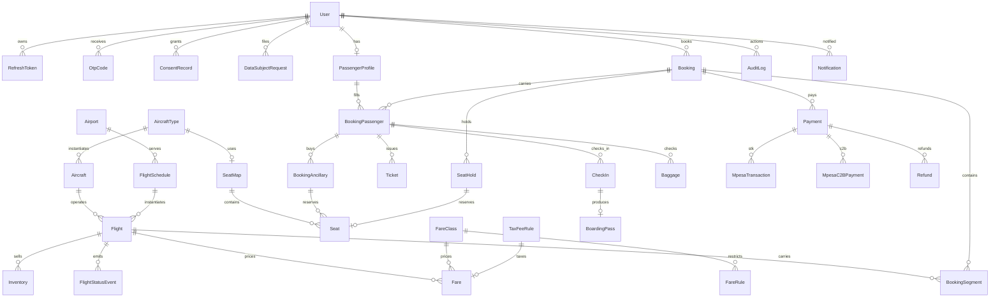
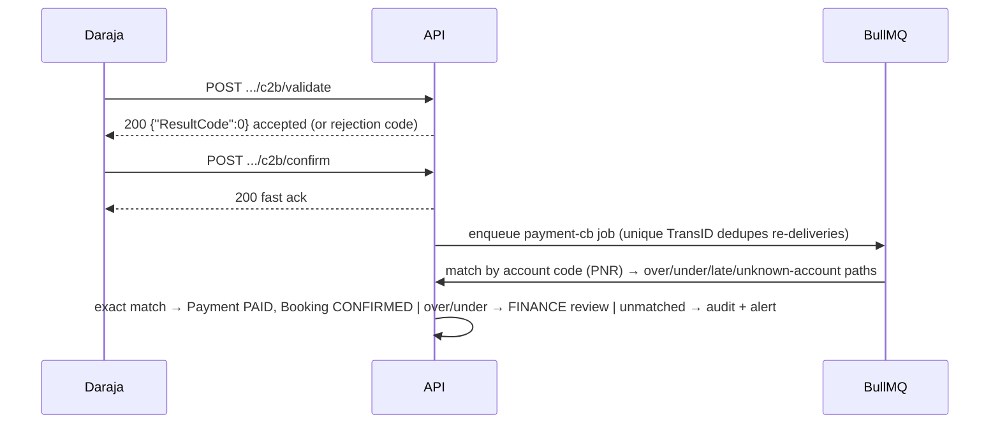

# Flight13 — Architecture

Companion to the [README](../README.md). Paths, contracts, and diagrams here are the
source of truth for implementation; where an earlier design note disagrees (for example the
M-Pesa callback path), this document wins.

## 1. System overview

```
                       ┌──────────────────────────────┐
  browser ──HTTPS────▶ │  apps/web  (Next.js :3000)   │  App Router, mobile-first,
                       │  server + client components  │  EN/SW, cookie locale
                       └──────────────┬───────────────┘
                                      │ REST /api/v1  +  Socket.IO /rt
                       ┌──────────────▼───────────────┐
                       │  apps/api   (NestJS :4000)   │
                       │  controllers → services      │
                       │  BullMQ workers · guards     │
                       └───┬──────────┬──────────┬────┘
                           │          │          │
                     Prisma│     Redis│          │ outbound
                           ▼          ▼          ▼
                     Postgres      Redis     Daraja (M-Pesa),
                     (source of    (cache,   Stripe, Africa's
                      truth)       queues,   Talking SMS,
                                   rate-     (mock via env flag)
                                   limits)
```

- **Monorepo**: pnpm workspaces — `apps/web`, `apps/api`, `packages/shared`.
- **`packages/shared`** holds every cross-app contract: money math, phone/MSISDN, PNR
  checksum, the booking-state transition table, M-Pesa result codes, WS event catalog,
  and API DTO types. No app re-implements these.
- **Config** is a single Zod-validated module (`apps/api/src/config/env.ts`). Boot fails
  loudly on invalid config; nothing reads `process.env` anywhere else.

## 2. Folder structure

```
apps/api
├── src
│   ├── config/env.ts            Zod env contract + loader (only place env is read)
│   ├── common/                  logger (PII masking), AES-GCM crypto, blind index,
│   │                            Nest↔structured-logger bridge
│   ├── prisma/                  PrismaModule (global), PrismaService ($connect/ping)
│   ├── redis/                   RedisModule (global), RedisService (ioredis)
│   ├── app.module.ts            module graph
│   ├── app.setup.ts             shared configureApp() used by main.ts AND e2e tests
│   ├── main.ts                  bootstrap (fatal-error logging)
│   └── modules/                 one folder per bounded context
│       ├── health/              /healthz /readyz
│       ├── meta/                /api/v1/meta
│       └── flights/             /api/v1/airports (search lands here in M3)
├── prisma/schema.prisma         34 models, 29 enums
├── prisma/migrations/
├── prisma/seed.ts               idempotent, re-runnable
└── test/                        Vitest + Supertest e2e

apps/web
└── src
    ├── app/                     App Router: layout, page, loading, not-found, actions
    ├── components/              site chrome + shadcn-style ui primitives
    ├── lib/                     env, fetch client, i18n, cn()
    └── messages/{en,sw}.json    locale bundles (parity-tested)

packages/shared/src
└── constants · domain · money · phone · pnr · time · booking-state ·
    mpesa-codes · errors · i18n · ws-events · api-contracts
```

## 3. Data model (ER)



### Key modeling decisions

| Decision                                                                 | Rationale                                                                                       |
| ------------------------------------------------------------------------ | ----------------------------------------------------------------------------------------------- |
| All money is **integer minor units** (`Int`) + `Currency`                | No float drift; `formatKes()` renders `KES 12,500`                                              |
| All timestamps `DateTime` stored **UTC**, display via airport tz         | Nairobi default `Africa/Nairobi`; DXB/LHR shown local                                           |
| `Flight` is the sellable instance of `FlightSchedule` + date             | Inventory, fares, and status hang off the instance                                              |
| `Inventory` row per `(flight, fareClass)` with `seatsAvailable`          | Updated with row-level locking — no double-booking (M4)                                         |
| `SeatHold` with `HoldStatus` + TTL (Redis `SETEX` mirror)                | Atomic hold→book; expiry sweeps via BullMQ                                                      |
| `Payment` is the intent; provider records hang off it                    | One provider interface, many backends, one audit trail                                          |
| PII (passport/ID) **AES-256-GCM encrypted** + **blind index** for lookup | Kenya DPA 2019: minimise, encrypt, be able to delete                                            |
| `AuditLog` append-only, `StatusSource` on every status change            | KCAA + dispute trail                                                                            |
| Tax/fee rules are **DB rows** (`TaxFeeRule`, per route type)             | Finance can reconfigure without a deploy — **values are placeholders pending finance sign-off** |

## 4. API surface

Global prefix `/api/v1` (probes `/healthz`, `/readyz` are deliberately outside it).
OpenAPI served at `/api/docs` (disabled when `ENABLE_SWAGGER=false`).

**Implemented (M1–M2)**

| Method | Path                                    | Notes                                                  |
| ------ | --------------------------------------- | ------------------------------------------------------ |
| GET    | `/healthz`                              | liveness, no deps                                      |
| GET    | `/readyz`                               | 503 when Postgres/Redis down                           |
| GET    | `/api/v1/meta`                          | airline, currency, locales, timezone                   |
| GET    | `/api/v1/airports`                      | airport directory                                      |
| POST   | `/api/v1/auth/register`                 | account + consent records, starts session              |
| POST   | `/api/v1/auth/login`                    | per-IP throttle, lockout, audited outcomes             |
| POST   | `/api/v1/auth/refresh`                  | rotation; replay revokes the token family              |
| POST   | `/api/v1/auth/logout`                   | family revoke + Redis denylist (kills access JWT)      |
| GET    | `/api/v1/auth/me`                       | session probe → `SessionUserDto`                       |
| POST   | `/api/v1/auth/otp/request`              | MFA-ready OTP dispatch (mock SMS provider)             |
| POST   | `/api/v1/auth/otp/verify`               | OTP consume (hashed, attempt-limited)                  |
| GET    | `/api/v1/admin/users`                   | `ADMIN`-only directory                                 |
| GET    | `/api/v1/flights/search`                | priced, availability-checked flight options (M3)       |
| GET    | `/api/v1/flights/:id`                   | flight detail with local times and fares (M3)          |
| GET    | `/api/v1/flights/:id/fares`             | priced fare options for one flight (M3)                |
| GET    | `/api/v1/fare-classes`                  | active fare classes + EN/SW rules (M3)                 |
| POST   | `/api/v1/bookings`                      | create HELD booking, atomic inventory reservation (M4) |
| GET    | `/api/v1/bookings`                      | my bookings, paginated (M4)                            |
| GET    | `/api/v1/bookings/:id`                  | booking detail — owner or staff (M4)                   |
| POST   | `/api/v1/bookings/:id/cancel`           | cancel + inventory release (M4)                        |
| POST   | `/api/v1/bookings/:id/seats`            | hold a seat (DB-unique activeKey) (M4)                 |
| DELETE | `/api/v1/bookings/:id/seats/:seatLabel` | release a seat (M4)                                    |

Sessions are httpOnly cookies: `f13_at` (access, 15 min) and `f13_rt` (refresh, 7 d,
rotating); `Authorization: Bearer` also works for the access token. Global guard order is
`JwtAuthGuard` → `RolesGuard`; public routes carry `@Public()`.

**Planned (by milestone)**

| Milestone | Endpoints                                                                                                                                                                                                                                                                                                                                                                                       |
| --------- | ----------------------------------------------------------------------------------------------------------------------------------------------------------------------------------------------------------------------------------------------------------------------------------------------------------------------------------------------------------------------------------------------- |
| M2        | ~~auth, roles, guards, OTP~~ ✅ done                                                                                                                                                                                                                                                                                                                                                            |
| M3        | ~~`GET /flights/search`, `GET /flights/:id`, `GET /flights/:id/fares`, `GET /fare-classes`~~ ✅ done                                                                                                                                                                                                                                                                                            |
| M4        | ~~`POST /bookings`, `GET /bookings`, `GET /bookings/:id`, `POST /bookings/:id/cancel`, `POST /bookings/:id/seats`, `DELETE /bookings/:id/seats/:seatLabel`~~ ✅ done (expiry via BullMQ sweep)                                                                                                                                                                                                  |
| M5        | ~~`POST /payments`, `GET /payments?bookingId=`, `GET /payments/:id`, `POST /payments/:id/stk`, `POST /payments/:id/simulate` (mock), `POST /payments/:id/refund` (FINANCE + OTP), `POST /payments/cb/:secret/stk`, `POST /payments/cb/:secret/c2b/validate`, `POST /payments/cb/:secret/c2b/confirm`, `POST /payments/cb/:secret/stripe`~~ ✅ done (BullMQ workers + `payment-reconcile` sweep) |
| M6        | `GET /pnr/:code`, `POST /ticketing/issue`, `GET /flights/:id/status`, ops status endpoints                                                                                                                                                                                                                                                                                                      |
| M7        | `GET /flights/:id/seats`, `POST /check-in`, `GET /boarding-passes/:id`                                                                                                                                                                                                                                                                                                                          |
| M8        | `GET /ops/manifests`, `POST /ops/manifests/:id/dispatch` (KCAA hook), `GET /reports/*`                                                                                                                                                                                                                                                                                                          |
| M9        | `GET/POST /me/consents`, `POST /me/dsar` (access/export/delete), retention jobs                                                                                                                                                                                                                                                                                                                 |

## 5. Real-time catalog (Socket.IO, namespace `/rt`)

Rooms: `user:{id}`, `booking:{id}`, `flight:{id}` (see `packages/shared/src/ws-events.ts`).

| Event                               | Room    | Payload gist                                   |
| ----------------------------------- | ------- | ---------------------------------------------- |
| `booking.status`                    | booking | state-machine transition, actor, timestamp     |
| `booking.expiring`                  | booking | seconds left on unpaid hold                    |
| `payment.status`                    | booking | intent status + typed M-Pesa result code       |
| `flight.status`                     | flight  | `FlightStatus` + `StatusSource`                |
| `seat.taken`                        | flight  | seat id removed from map (conflict resolution) |
| `checkin.opened` / `checkin.closed` | flight  | window changes                                 |
| `notify`                            | user    | i18n message key + params (SMS mirrors it)     |

Auth: JWT from the same access token as REST, validated on the handshake.

## 6. Payments

Provider selection is a typed interface (`PaymentProvider`) with implementations
`MpesaProvider` (STK + C2B), `StripeProvider`, `MockProvider` — chosen at boot by
`PAYMENT_PROVIDER_DEFAULT` plus `MPESA_MODE` / `STRIPE_MODE` (mock by default, no network
calls in dev/CI). One **active** provider per environment; the others never load.

All provider callbacks funnel through one Prisma transaction with conditional claims
(`MpesaTransaction` → `Payment` → `bookings.confirmPaid`), so duplicate or lost-then-replayed
deliveries can never double-confirm. HTTP handlers only validate, persist and enqueue
(`payment-cb` queue, jobId dedupe); a repeat worker (`payment-reconcile`, every
`RECONCILE_STK_AFTER_SECONDS`) polls stale `PENDING` attempts and applies terminal results.

**Callback path (authoritative):** `POST /api/v1/payments/cb/:secret/…` — neutral path,
no `mpesa`/`safaricom` strings in the registered URL. `:secret` is `MPESA_CALLBACK_SECRET`
(a path token, since Safaricom does not sign callbacks) and the endpoint additionally
enforces source-IP allowlist + strict payload validation. _(Design note: an earlier sketch
said `/api/payments/cb/…`; the `/api/v1` prefix above is what ships.)_

### STK Push sequence

```mermaid
sequenceDiagram
    participant C as Client
    participant A as API
    participant Q as BullMQ
    participant D as Daraja
    C->>A: POST /payments {bookingId}
    A->>A: create Payment intent (REQUIRES_ACTION), audit log
    A->>D: OAuth token (cached in Redis until expiry)
    A->>D: STK Push<br/>Password=base64(Shortcode+Passkey+Timestamp)<br/>AccountReference=PNR(≤12), Desc="Flight13"
    D-->>A: CheckoutRequestID
    A->>A: persist MpesaTransaction (PENDING)
    A-->>C: 201 Payment DTO (fast; providerRef = CheckoutRequestID)
    D-->>A: POST /api/v1/payments/cb/:secret/stk (async)
    A-->>D: 200 {"ResultCode":0,...}  (ack immediately)
    A->>Q: enqueue payment-cb job (jobId dedupe — DB claim is authoritative)
    Q->>A: map ResultCode 0/1/1032/1037/2001 → typed message
    A->>A: one transaction, conditional claims → Payment PAID, Booking CONFIRMED
    A-->>C: WS payment.status + booking.status
```

Late/duplicate callbacks re-enter the same idempotent job and never double-confirm.

### C2B confirmation sequence



Refunds require the `FINANCE` role **and** an OTP step-up before dispatch; every transition
is audited and logged with PII masked.

## 7. Security & compliance

- **Auth**: JWT access (15 min) + rotating refresh in httpOnly cookies; roles
  `PASSENGER · AGENT · OPS · FINANCE · ADMIN`; login throttling + OTP (SMS) hooks.
- **Transport**: helmet, CORS allowlist from env, rate limits (global + stricter auth).
- **Secrets**: only from Zod-validated env; `.env` is git-ignored and generated by
  `pnpm bootstrap`.
- **PII**: encrypted at rest, blind-indexed for lookup, masked in every log line; DPA 2019
  consent records, data-subject access/export/delete requests, retention policy (M9).
- **KCAA manifest** dispatch is an interface (`ManifestDispatcher`) with a no-op default —
  a government endpoint can be plugged in without touching booking code.

## 8. Milestone plan

| #   | Scope                                                        | Exit criteria                                                |
| --- | ------------------------------------------------------------ | ------------------------------------------------------------ |
| M1  | Monorepo, schema + seed, health/meta/airports, swagger, docs | `pnpm verify` green; API boots; seed re-runnable             |
| M2  | ✅ Auth, roles, guards, OTP, refresh rotation                | register/login/refresh-replay/logout e2e, lockout, RBAC, OTP |
| M3  | ✅ Search, fares, tax application                            | search returns priced options incl. taxes                    |
| M4  | ✅ Booking + seat holds                                      | concurrency test proves no double-booking                    |
| M5  | ✅ Payments (STK, C2B, Stripe, refunds, recon)               | duplicate/lost callbacks never double-confirm                |
| M6  | PNR, ticketing, Socket.IO status                             | real-time propagation test                                   |
| M7  | Seats, check-in, boarding pass                               | full search→book→pay→check-in flow green                     |
| M8  | Ops workspace, KCAA hooks, reporting                         | manifest hook unit-tested with fake endpoint                 |
| M9  | DPA flows, i18n, hardening                                   | export/delete tests; SW translations complete                |
| M10 | Load, CI/CD polish, Playwright, observability                | CI runs verify + docker build; soak test                     |

Each milestone ends with lint + typecheck + tests green and a conventional commit.
